<p align="right"><a href="README.md">English</a> | <b>Español</b></p>

<a href="https://www.raulveneri.com/">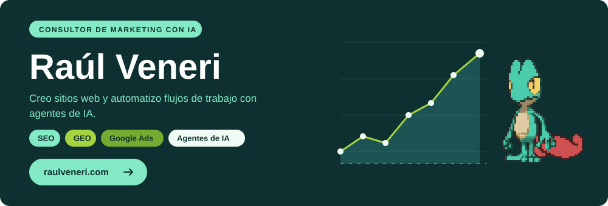</a>

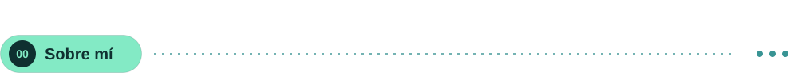

Soy consultor de marketing con IA. Trabajo en SEO, GEO y Google Ads, creo sitios web y automatizo flujos de trabajo con agentes de IA.

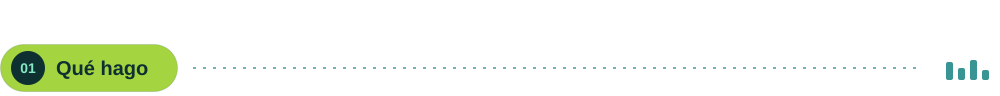

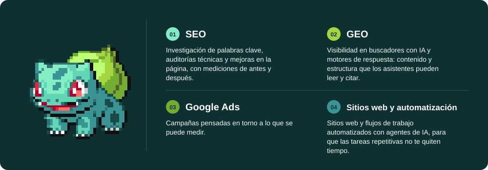

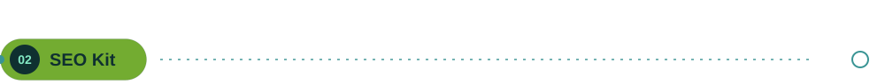

<a href="https://github.com/raulveneri/seo-kit">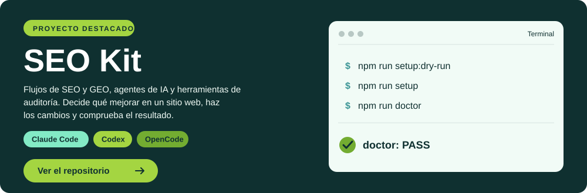</a>

<br>

<table>
<tr><td width="50%" valign="top">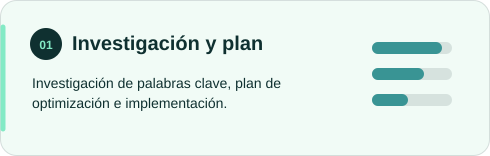</td><td width="50%" valign="top">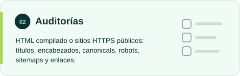</td></tr>
<tr><td width="50%" valign="top">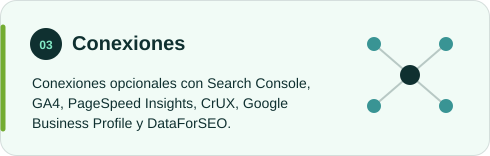</td><td width="50%" valign="top">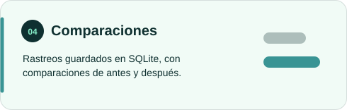</td></tr>
</table>

<br>

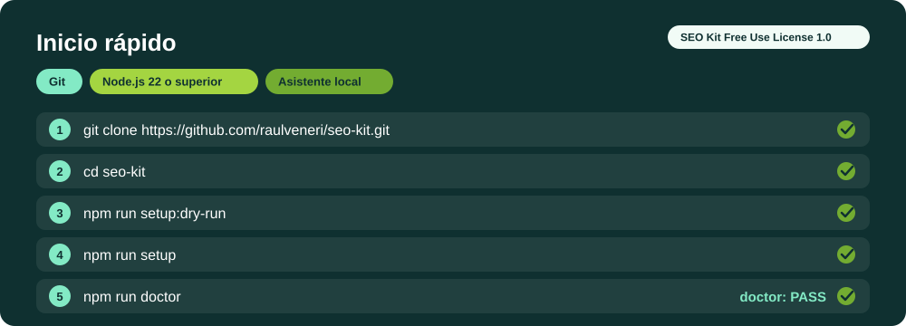

<br>

<details>
<summary>Copiar los comandos</summary>

```bash
git clone https://github.com/raulveneri/seo-kit.git
cd seo-kit
npm run setup:dry-run
npm run setup
npm run doctor
```

</details>

Licencia: SEO Kit Free Use License 1.0. [Ver el repositorio](https://github.com/raulveneri/seo-kit).

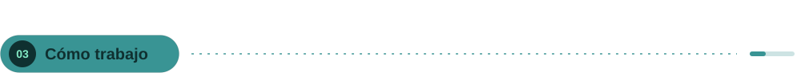

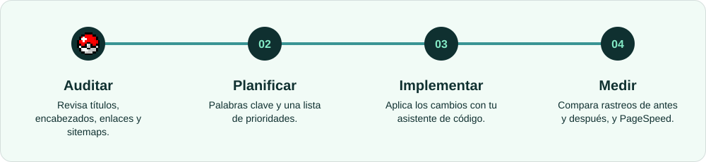

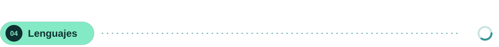

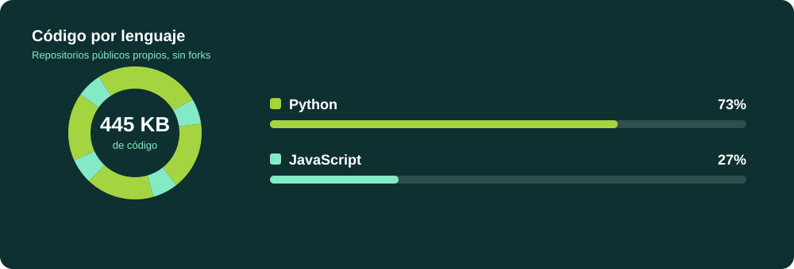

Los porcentajes reflejan el tamaño del código en repositorios públicos propios, sin forks. Actualización diaria.

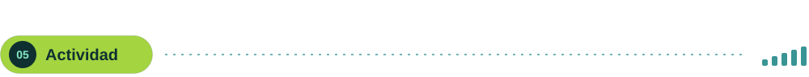

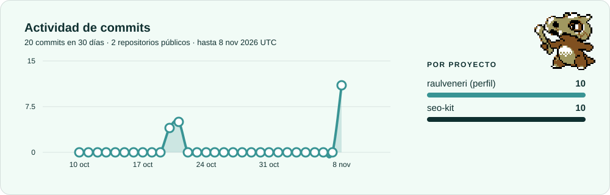

Commits de mi autoría en la rama predeterminada de cada repositorio durante los últimos 30 días UTC. Actualización diaria.

[Estado de actualización de las gráficas: ](https://github.com/raulveneri/raulveneri/actions/workflows/profile-charts.yml)

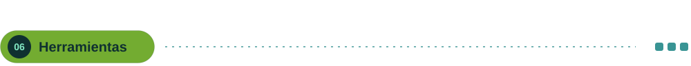

<table>
<tr><td width="25%" valign="top">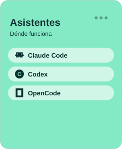</td><td width="25%" valign="top">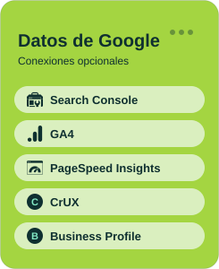</td><td width="25%" valign="top">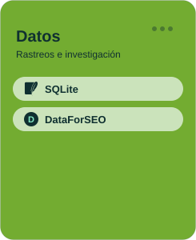</td><td width="25%" valign="top">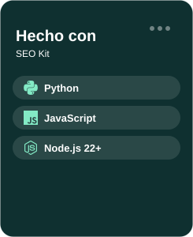</td></tr>
</table>

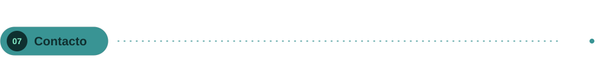

<a href="https://www.raulveneri.com/">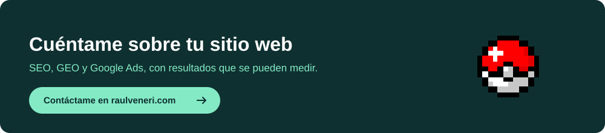</a>

[Contacta conmigo](https://www.raulveneri.com/contacto/)
