<p align="right"><b>English</b> | <a href="README.es.md">Español</a></p>

<a href="https://www.raulveneri.com/">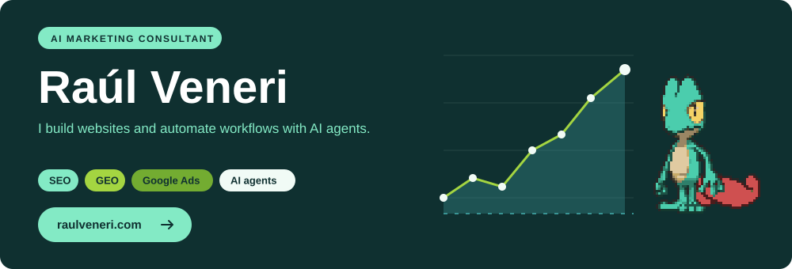</a>

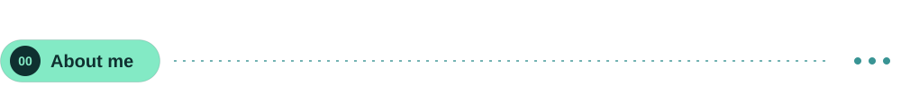

I am an AI marketing consultant. I work on SEO, GEO and Google Ads, build websites and automate workflows with AI agents.

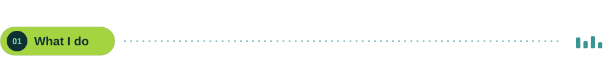

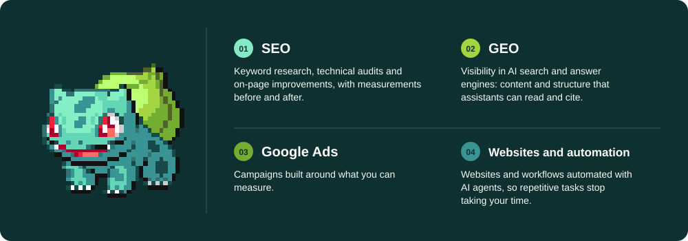

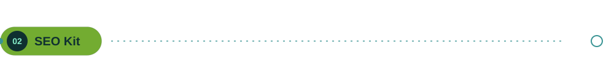

<a href="https://github.com/raulveneri/seo-kit">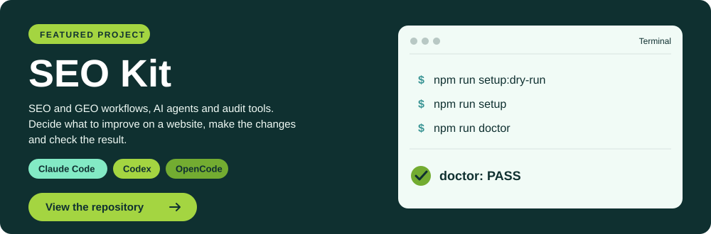</a>

<br>

<table>
<tr><td width="50%" valign="top">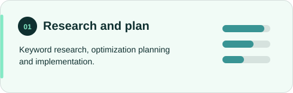</td><td width="50%" valign="top">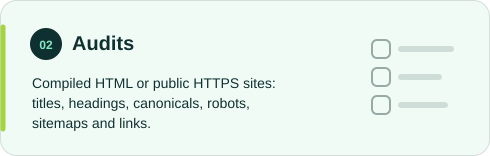</td></tr>
<tr><td width="50%" valign="top">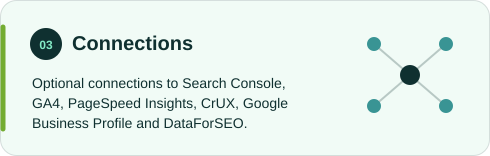</td><td width="50%" valign="top">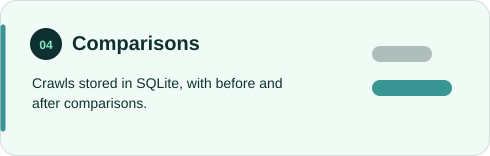</td></tr>
</table>

<br>

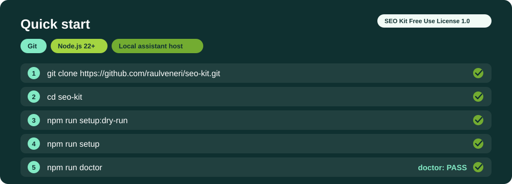

<br>

<details>
<summary>Copy the commands</summary>

```bash
git clone https://github.com/raulveneri/seo-kit.git
cd seo-kit
npm run setup:dry-run
npm run setup
npm run doctor
```

</details>

License: SEO Kit Free Use License 1.0. [View the repository](https://github.com/raulveneri/seo-kit).

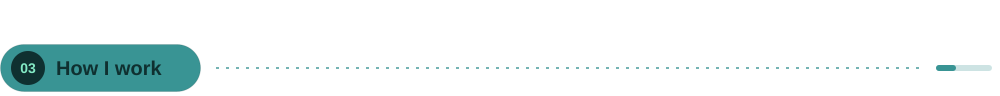

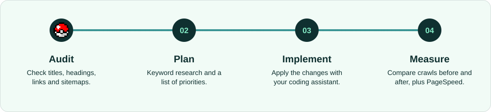

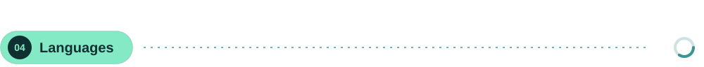

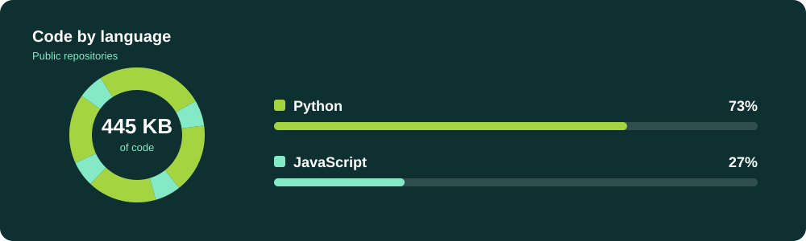

Language percentages use code size in owned public repositories, excluding forks. Updated daily.

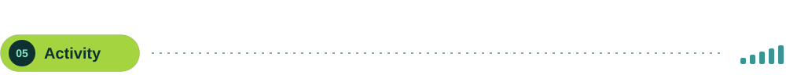

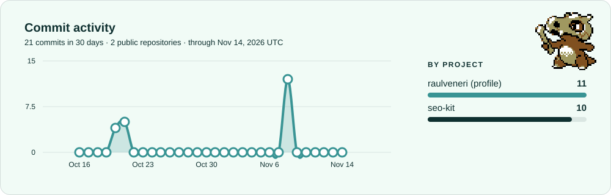

Commits authored by me on each repository’s default branch during the last 30 UTC days. Updated daily.

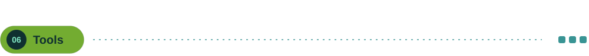

<table>
<tr><td width="25%" valign="top">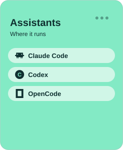</td><td width="25%" valign="top">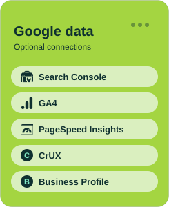</td><td width="25%" valign="top">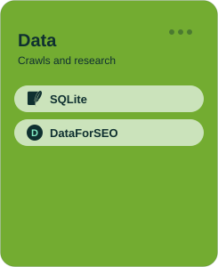</td><td width="25%" valign="top">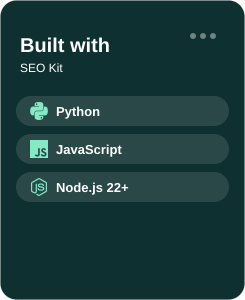</td></tr>
</table>

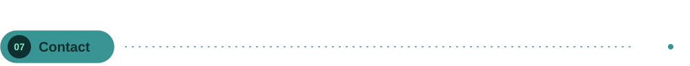

<a href="https://www.raulveneri.com/">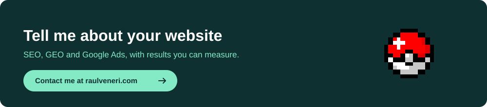</a>
