# Raúl Veneri

Marketing, código y agentes de IA

<picture>
  <source media="(prefers-reduced-motion: reduce) and (max-width: 1023px)" srcset="assets/raulveneri-profile-heading--mobile--static.svg">
  <source media="(prefers-reduced-motion: reduce)" srcset="assets/raulveneri-profile-heading--static.svg">
  <source media="(max-width: 1023px)" srcset="assets/raulveneri-profile-heading--mobile.svg">
  
</picture>

Trabajo con **SEO, Google Ads y automatización**. Desarrollo herramientas que utilizo en mis proyectos y comparto cómo trabajo con ellas, paso a paso.

[Mi web](https://www.raulveneri.com/) · [Mis guías](https://www.raulveneri.com/guias/) · [Mis repositorios públicos](https://github.com/raulveneri?tab=repositories&type=source) · [Quiero hablar de mi proyecto](https://www.raulveneri.com/contacto/)

## SEO Kit

**Mi herramienta de SEO. La uso en mi día a día y la voy actualizando.**

Con SEO Kit puedes analizar una web, detectar problemas técnicos y de contenido, entender qué está pasando y decidir qué mejorar. Funciona con **Claude Code, Codex y OpenCode**.

Si estás empezando, te guía y explica los hallazgos. Si ya tienes experiencia, puedes profundizar en el análisis, incorporar tus datos y contrastar propuestas.

Cuando una decisión necesita contexto o criterio humano, te presenta opciones y sus implicaciones. Tú decides por dónde seguir. Después, te ayuda a aplicar los cambios y comprobar el resultado. Si faltan datos para concluir algo, lo deja indicado.

SEO Kit en acción

<a href="https://github.com/raulveneri/seo-kit">
  <picture>
    <source media="(prefers-reduced-motion: reduce) and (max-width: 1023px)" srcset="assets/raulveneri-seo-kit-demonstration--mobile--static.svg">
    <source media="(prefers-reduced-motion: reduce)" srcset="assets/raulveneri-seo-kit-demonstration--static.svg">
    <source media="(max-width: 1023px)" srcset="assets/raulveneri-seo-kit-demonstration--mobile.svg">
    
  </picture>
</a>

La animación adapta el [ejemplo documentado de SEO Kit](https://github.com/raulveneri/seo-kit#ask-codex-for-an-audit): una auditoría de dos páginas locales detecta un enlace roto. Corregir el enlace o recuperar la página son alternativas que dependen del proyecto.

[Quiero ver SEO Kit](https://github.com/raulveneri/seo-kit) · [Quiero empezar paso a paso](https://github.com/raulveneri/seo-kit/blob/main/docs/GETTING_STARTED.md)

## Lo que voy aprendiendo, lo explico aquí

En [raulveneri.com](https://www.raulveneri.com/) comparto guías sobre agentes, SEO y herramientas que uso. Cuento cómo monto las cosas, dónde me atasco y qué cambio para que funcionen.

Un vistazo a mi web

<a href="https://www.raulveneri.com/guias/">
  <picture>
    <source media="(prefers-reduced-motion: reduce) and (max-width: 1023px)" srcset="assets/raulveneri-website-guides--mobile--static.svg">
    <source media="(prefers-reduced-motion: reduce)" srcset="assets/raulveneri-website-guides--static.svg">
    <source media="(max-width: 1023px)" srcset="assets/raulveneri-website-guides--mobile.svg">
    
  </picture>
</a>

[Quiero leer las guías](https://www.raulveneri.com/guias/) · [Quiero conocer tu trabajo](https://www.raulveneri.com/)

## Con qué lo construyo

Las herramientas que uso

<picture>
  <source media="(prefers-reduced-motion: reduce) and (max-width: 1023px)" srcset="assets/raulveneri-development-tools--mobile--static.svg">
  <source media="(prefers-reduced-motion: reduce)" srcset="assets/raulveneri-development-tools--static.svg">
  <source media="(max-width: 1023px)" srcset="assets/raulveneri-development-tools--mobile.svg">
  
</picture>

**Python · JavaScript · TypeScript · Astro · Tailwind CSS · Cloudflare**

Trabajo con **Claude Code, Codex y OpenCode** para dar contexto a los agentes, repartir tareas y revisar sus resultados. Uso Git y GitHub para mantener los cambios y comprobar qué se ha hecho.

Puedes cerrar cada bloque desde su título para ocultar el movimiento. Si prefieres, aquí tienes las imágenes estáticas.

Ver las imágenes sin animación

<picture>
  <source media="(max-width: 1023px)" srcset="assets/raulveneri-profile-heading--mobile--static.svg">
  
</picture>

<a href="https://github.com/raulveneri/seo-kit">
  <picture>
    <source media="(max-width: 1023px)" srcset="assets/raulveneri-seo-kit-demonstration--mobile--static.svg">
    
  </picture>
</a>

<a href="https://www.raulveneri.com/guias/">
  <picture>
    <source media="(max-width: 1023px)" srcset="assets/raulveneri-website-guides--mobile--static.svg">
    
  </picture>
</a>

<picture>
  <source media="(max-width: 1023px)" srcset="assets/raulveneri-development-tools--mobile--static.svg">
  
</picture>

**[Quiero hablar de mi proyecto](https://www.raulveneri.com/contacto/)**
