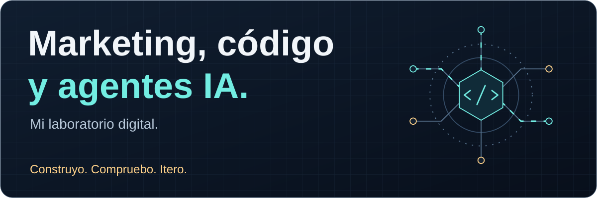
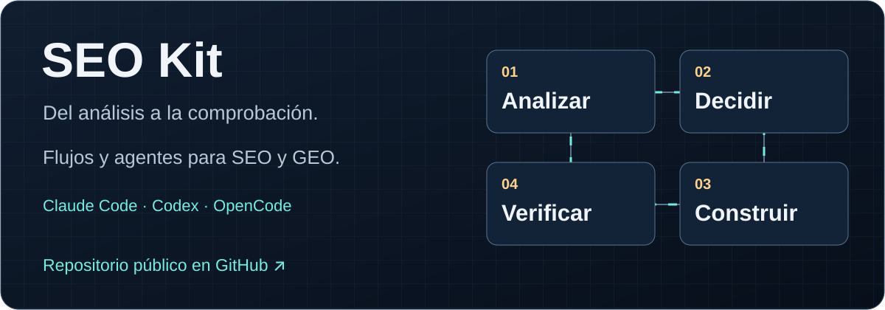
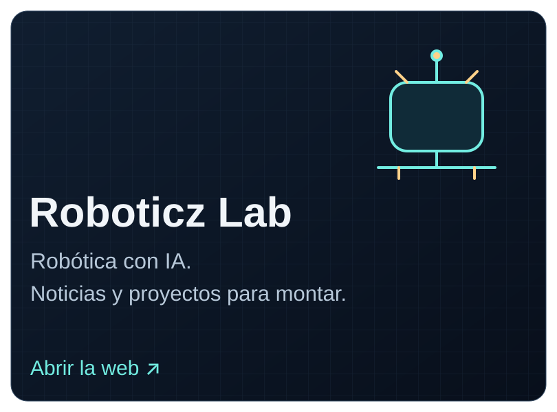
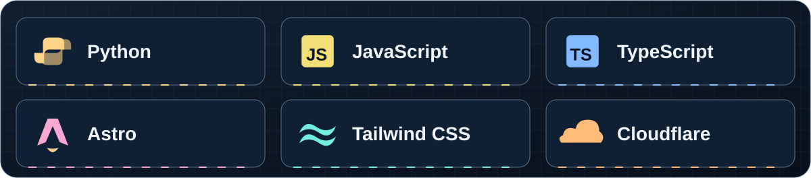

# Raúl Veneri

<picture>
  <source media="(max-width: 600px)" srcset="assets/raulveneri-digital-laboratory--mobile.svg">
  
</picture>

Construyo webs y sistemas con agentes de inteligencia artificial para trabajar el **SEO, la visibilidad en buscadores con IA y Google Ads**. Vengo de la parte técnica: monto el sistema, reviso lo que hace e itero con datos.

Aquí comparto herramientas y proyectos propios. Mi web también es mi laboratorio: lo que aprendo construyendo, lo explico paso a paso.

[Mi web](https://www.raulveneri.com/) · [Mis guías](https://www.raulveneri.com/guias/) · [Mis repositorios públicos](https://github.com/raulveneri?tab=repositories&type=source) · [Quiero hablar de mi proyecto](https://www.raulveneri.com/contacto/)

## Lo que estoy construyendo

<a href="https://github.com/raulveneri/seo-kit">
  <picture>
    <source media="(max-width: 600px)" srcset="assets/raulveneri-search-optimization-toolkit--mobile.svg">
    
  </picture>
</a>

### SEO Kit

Mi kit de flujos, agentes y herramientas para investigar, auditar y mejorar una web. Incluye SEO y GEO, es decir, posicionamiento en buscadores y visibilidad en sus respuestas con IA. Se puede usar con **Claude Code, Codex y OpenCode**.

[Repositorio de SEO Kit](https://github.com/raulveneri/seo-kit) · [Guía para empezar](https://github.com/raulveneri/seo-kit/blob/main/docs/GETTING_STARTED.md)

  
  

### Mi web y Roboticz Lab

- **[raulveneri.com](https://www.raulveneri.com/):** mi web de marketing con IA. La migré de WordPress a Astro y comparto guías sobre las herramientas y procesos que uso.
- **[Roboticz Lab](https://www.roboticzlab.com/es/):** mi proyecto de robótica con IA. Noticias con fuentes y guías para entender qué conectar, cómo montarlo y por qué funciona.

## Con qué lo construyo

<picture>
  <source media="(max-width: 600px)" srcset="assets/raulveneri-development-stack--mobile.svg">
  
</picture>

**Python · JavaScript · TypeScript · Astro · Tailwind CSS · Cloudflare**

Trabajo con **Claude Code, Codex y OpenCode** para repartir tareas, dar contexto a los agentes y revisar sus resultados. Uso Git y GitHub para mantener los cambios y comprobar qué se ha hecho.

## Cómo trabajo

1. **Entiendo el problema.** Reviso qué hay, qué falta y qué merece la pena construir.
2. **Monto el sistema.** Doy contexto y tareas concretas a los agentes.
3. **Compruebo el resultado.** Reviso cambios, ejecuto las comprobaciones e itero cuando algo falla.
4. **Comparto lo aprendido.** Lo convierto en herramientas y guías que se puedan seguir.

Si estás empezando, puedes entrar por [mis guías de IA y herramientas](https://www.raulveneri.com/guias/). Explico cómo lo trabajo, paso a paso.

**[Quiero hablar de mi proyecto](https://www.raulveneri.com/contacto/)**
